# 아파트 매매가 변동에 따른 지역별 인구 유입·유출 예측 – 수원시 영통구

수원시 영통구 12개 행정동의 월별 아파트 실거래가와 인구 현황을 결합하여, **다음 달 인구가 감소(유출)할지 예측**하는 머신러닝 프로젝트입니다.
예측 확률을 바탕으로 동별 **예상 인구 감소와 위험등급(LOW / MEDIUM / HIGH)** 을 산출하고, Streamlit 앱으로 확인할 수 있게 만들었습니다.

## 문제 정의

| 항목 | 내용 |
|---|---|
| 분석 단위 | 행정동(12개) × 월 |
| 목표 변수 | `outflow` = 1 (그 달 인구 증감 < 0), 0 (그 외) |
| 데이터 기간 | 실거래가 2023.10~2026.10, 모델 사용 구간 2024.03~2026.09 (372행) |
| 학습 / 테스트 | 시간 순서로 분할 – 학습 2024.03~2025.09 (228행), 테스트 2025.10~2026.09 (144행) |
| 교차검증 | `TimeSeriesSplit` 4폴드 (검증 3개월 = 36행), 미래 월로 과거를 맞히는 누수 방지 |

입력 변수는 모두 **예측 대상 월의 직전 월까지 확인된 값**입니다. (㎡당 가격, 1·3개월 가격 변동률과 시차 변수, 거래량, 신축 비율, 평균 건축연도, 전월 인구 증감률·인구·세대당 인구, 행정동, 월)

## 탐색적 데이터 분석 (EDA)

| 목표 변수 분포 | 목표 변수와의 상관계수 |
|---|---|
| 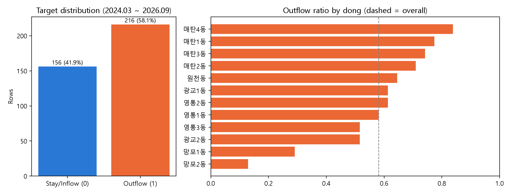 | 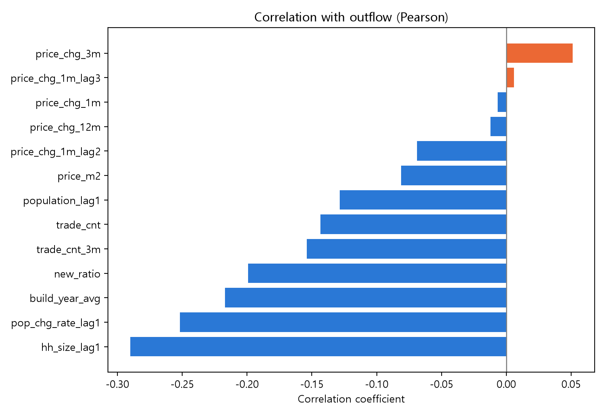 |

- 유출 216행 / 비유출 156행 (유출 58.1%)으로 한쪽으로 크게 치우치지 않았습니다.
- 목표 변수와의 상관계수는 모두 |r| < 0.3으로 약하며, 세대당 인구(−0.29)와 전월 인구 증감률(−0.25)이 상대적으로 큽니다.

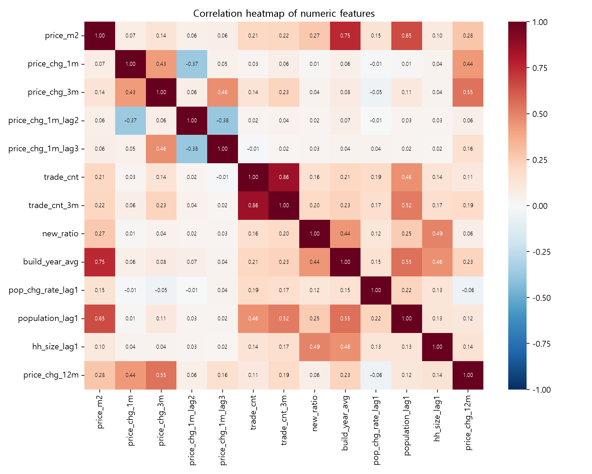

- 거래량–3개월 평균 거래량(0.86), ㎡당 가격–평균 건축연도(0.75)처럼 서로 상관이 높은 변수 쌍이 있습니다.

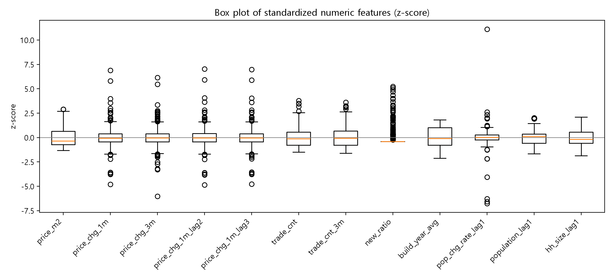

- 표준화한 수치 변수의 상자그림입니다. 이상치 후보는 실제 거래·인구 변화이므로 제거하지 않았습니다.

## 저장소 구성

```
├── code/
│   ├── 01_build_dataset.ipynb       # 실거래가 + 인구 결합, 학습 데이터셋 생성 (보고서 2.2)
│   ├── 01b_eda.ipynb                # 탐색적 데이터 분석 (2.1)
│   ├── 02_baseline_models.ipynb     # LR · RF · XGBoost 기본 모델 비교 (3.1~3.2.2)
│   ├── 03_tuning.ipynb              # GridSearchCV 하이퍼파라미터 탐색 (3.2.3)
│   ├── 04_feature_importance.ipynb  # 최종 모델 학습·저장, 변수 중요도 (3.2.4~3.3)
│   ├── 05_risk_grade.ipynb          # 예상 인구 감소 · 위험등급 (3.4)
│   ├── 06_streamlit_app.py          # Streamlit 앱 (4장)
│   ├── 07_search_comparison.ipynb   # GridSearchCV vs RandomizedSearchCV (부록 1)
│   └── requirements.txt
├── 데이터_csv/                      # 원천 데이터, 학습 데이터셋, 결과(results_*.csv)
├── model/                           # 최종 모델 (final_rf_pipeline.joblib, features_meta.joblib)
├── figures/                         # 보고서·README 그림
└── packages.txt                     # Streamlit Cloud용 한글 폰트(나눔고딕)
```

노트북은 번호 순서대로 실행하며, 실행 결과와 그래프가 함께 저장되어 있습니다.

## 최종 모델

규제한 Random Forest (`n_estimators=200`, `max_depth=2`, `min_samples_split=20`, `min_samples_leaf=5`)
전처리(`StandardScaler` + `OneHotEncoder`)와 모델을 하나의 `Pipeline`으로 묶어 저장했습니다.

| 지표 | 학습 | 테스트 |
|---|---|---|
| Accuracy | 0.798 | 0.625 |
| Precision | 0.779 | 0.643 |
| Recall | 0.918 | 0.768 |
| F1 Score | 0.843 | 0.700 |
| ROC-AUC | 0.884 | 0.648 |

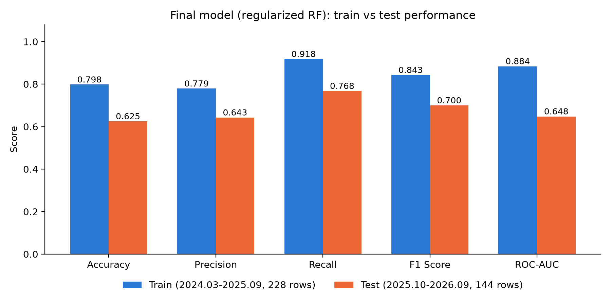

- 깊은 트리(1차 탐색)는 학습–테스트 Accuracy 차이가 0.354였으나, 깊이·리프 크기를 제한하여 0.173으로 줄였습니다.
- 비교 모델(Logistic Regression, XGBoost) 중 테스트 ROC-AUC가 가장 높았습니다.

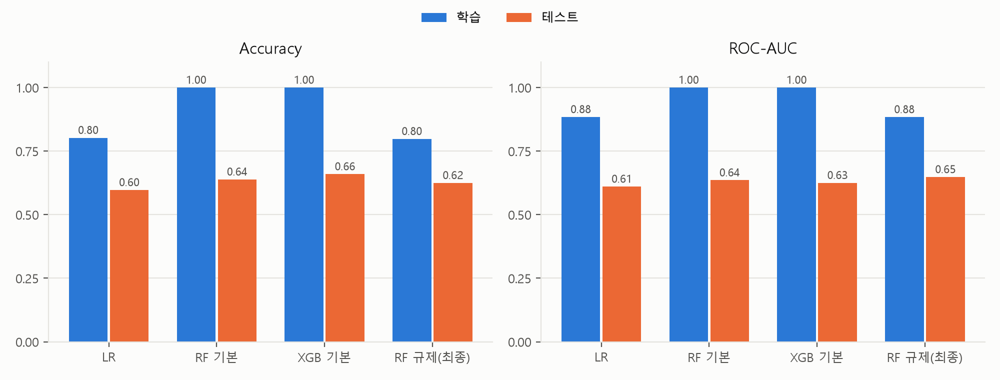

### 변수 중요도

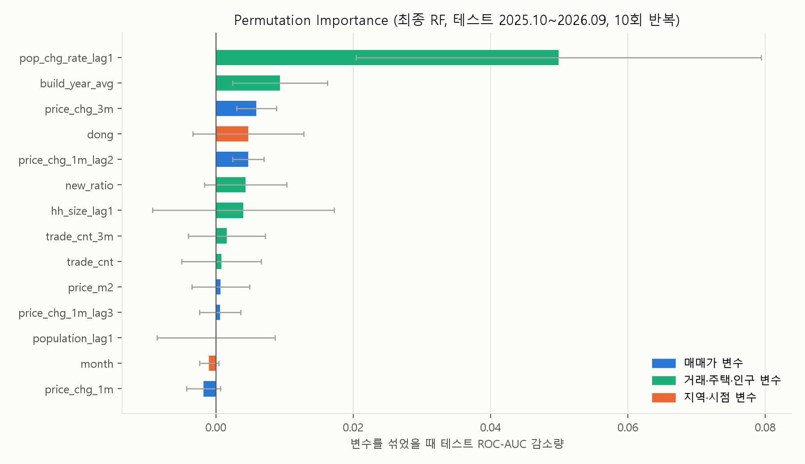

- Permutation importance 1위는 전월 인구 증감률(`pop_chg_rate_lag1`)이며, 가격 변수의 영향은 작았습니다.

## 위험등급

```
예상 인구 감소 = 유출 확률 × 전월 인구 × 동별 평균 감소율(학습 구간)
```

등급 기준은 학습 구간 예상 감소의 분위수(50% / 80%)로 정했습니다. MEDIUM ≥ 24.0명, HIGH ≥ 34.3명

| 등급 (테스트) | 행 수 | 실제 유출 비율 | 실제 평균 인구 증감 |
|---|---|---|---|
| LOW | 74 | 47.3% | +3.8명 |
| MEDIUM | 41 | 63.4% | −26.0명 |
| HIGH | 29 | 72.4% | −22.8명 |

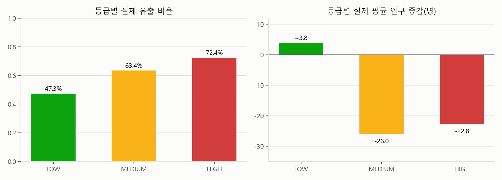

- 등급이 높을수록 실제 유출 비율이 높아져, 위험등급이 실제 인구 감소를 어느 정도 구분합니다.

## 실행 방법

```bash
pip install -r code/requirements.txt
```

- 노트북: `code/` 폴더의 노트북을 01 → 01b → 02 → 03 → 04 → 05 → 07 순서로 실행
- 앱: 저장소 폴더에서 아래 명령 실행

```bash
streamlit run code/06_streamlit_app.py
```

### 앱 화면

| 1. 행정동별 유출 예측 | 2. 행정동 위험 순위 |
|---|---|
| 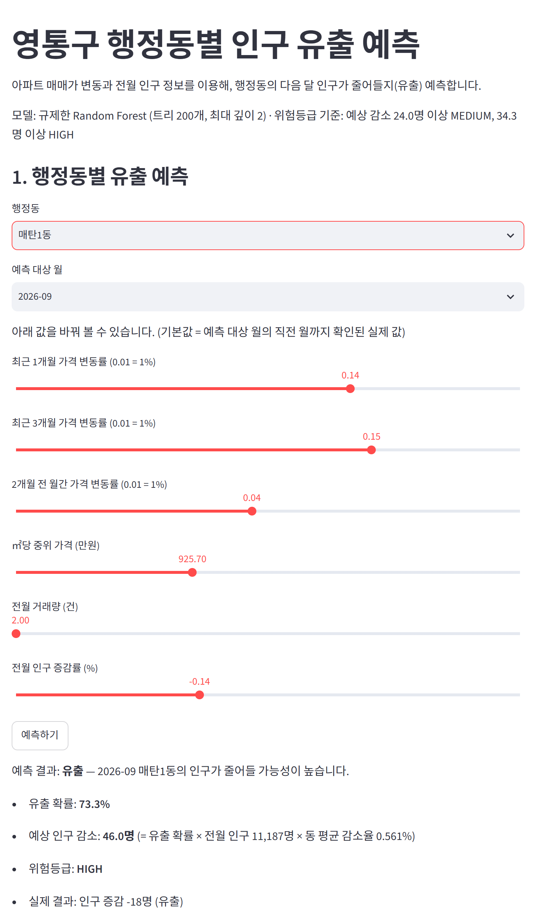 | 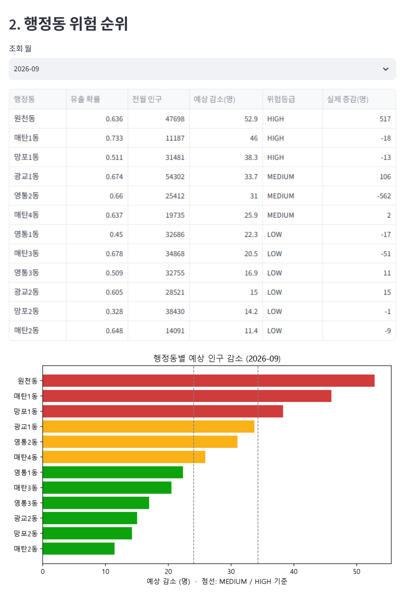 |
| 행정동·월을 고르고 가격 변동률 등을 슬라이더로 바꿔 유출 확률, 예상 인구 감소, 위험등급 확인 | 선택한 월의 12개 행정동을 예상 감소 순으로 표와 막대그래프로 표시 |

## 부록: GridSearchCV vs RandomizedSearchCV

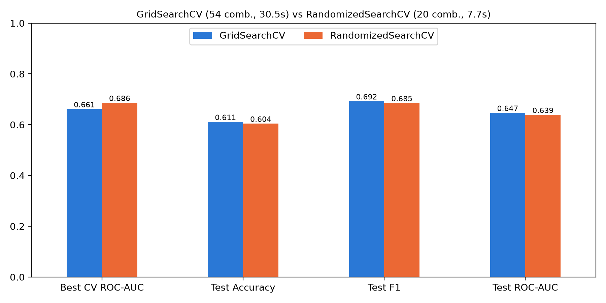

| 방법 | 조합 수 | CV ROC-AUC | 테스트 ROC-AUC | 탐색 시간 |
|---|---|---|---|---|
| GridSearchCV | 54 | 0.661 | 0.647 | 30.5초 |
| RandomizedSearchCV | 20 | 0.686 | 0.639 | 7.7초 |

- RandomizedSearchCV가 약 4배 빠르고 CV 점수도 높았지만, 테스트에서는 GridSearchCV가 조금 더 좋아 GridSearchCV 결과를 최종 모델로 유지했습니다.

## 한계

- 테스트 ROC-AUC 0.648로, 인구 변화에는 출생·사망 등 매매가 외 요인이 크게 작용합니다.
- 데이터 기간이 약 2년 반으로 짧고, 신규 아파트 입주 같은 일회성 사건의 영향을 받습니다.
- 앱은 데이터셋에 있는 과거 월(~2026.09)까지만 조회할 수 있습니다.
